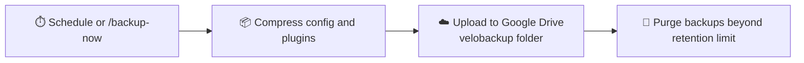

<div align="center">

# ☁️ VeloBackup

### Google Drive backups for your Velocity proxy, set up in minutes.

[](https://papermc.io/software/velocity)
[](https://adoptium.net/)
[](https://drive.google.com)
[](../../releases)

**Lightweight. Headless-friendly. Self-hosted. Zero web server required.**

[Features](#-features) • [Installation](#-installation) • [Linking Google Drive](#-linking-your-google-drive) • [Commands](#-commands) • [Configuration](#%EF%B8%8F-configuration) • [Troubleshooting](#-troubleshooting) • [Privacy Policy](#-privacy-policy)

</div>

---

## 📖 About

**VeloBackup** is a lightweight backup plugin built exclusively for **[Velocity](https://papermc.io/software/velocity)** Minecraft proxy servers. It compresses your proxy configuration and plugins and uploads them straight to **your own Google Drive**, with no complicated setup, no public IP, and no web server.

Link your account once with a short code, set an interval, and your proxy protects itself around the clock.

---

## ✨ Features

| | Feature | Description |
|---|---|---|
| ☁️ | **Direct Cloud Uploads** | Compresses your files and sends the zip straight to a dedicated `velobackup` folder on your Google Drive. |
| 🧹 | **Smart Storage Cleanup** | Automatically deletes older backups so your Drive never runs out of space. |
| 🔗 | **Simple Device Linking** | Headless-friendly code verification flow. No public IP or web server needed. |
| ⚡ | **Instant Manual Control** | Trigger a backup any time from the console or in-game chat. |
| ⏱️ | **Automated Scheduling** | Set a custom backup interval and let the server handle the rest. |
| 🔒 | **Self-Hosted & Private** | Files go to *your* Drive. Login tokens are stored locally on *your* server. |

---

## 🔄 How It Works



---

## 📋 Requirements

| Requirement | Version |
|---|---|
| **Velocity Proxy** | `3.3.0` or higher |
| **Java** | `17` or newer |
| **Google Account** | Personal Google Drive storage |

---

## 📦 Installation

1. **Download** `velobackup-1.0.0.jar` from the [Releases](../../releases) page.
2. **Drop** the jar into your Velocity `plugins/` folder.
3. **Start or restart** your Velocity proxy to generate the default configuration files.

```text
velocity/
└── plugins/
    ├── velobackup-1.0.0.jar
    └── velobackup/          ← generated on first start
```

---

## 🔑 Linking Your Google Drive

VeloBackup uses a **device-code flow**, so it works on any headless server with no browser on the machine.

1. Run this in your **server console** or **in-game chat**:
   ```
   /link-drive
   ```
2. Check the console output for your unique **User Code** and **Verification URL**.
3. Open the link in **any browser** (phone, laptop, anywhere), enter the code, and sign in with your Google account.

> [!NOTE]
> Because this is a private plugin, Google may show an **unverified app warning**. This is expected. Click **Advanced**, then click **Go to VeloBackup (unsafe)** to finish linking.

> [!TIP]
> Changed Google accounts or revoked access? Just run `/link-drive` again to generate a new token.

---

## 🎮 Commands

| Command | Description |
|---|---|
| `/link-drive` | Starts the secure account-linking flow to pair your Google Drive. |
| `/backup-now` | Triggers an immediate manual backup of your server configuration and plugins. |

---

## ⚙️ Configuration

After the first start, open `plugins/velobackup/` and edit the generated config file.

| Option | What it does |
|---|---|
| **Backup Interval** | How often the proxy automatically creates and uploads a backup in the background. |
| **Retention Limit** | How many past backups to keep on Google Drive before the oldest are automatically purged. |

Restart your proxy after changing the config so the new values take effect.

---

## 🔧 Troubleshooting

<details>
<summary><b>How do I confirm a backup succeeded?</b></summary>

Watch your Velocity console output. VeloBackup logs upload results there, and you can also check the `velobackup` folder in your Google Drive.
</details>

<details>
<summary><b>I switched Google accounts or revoked access.</b></summary>

Run `/link-drive` again to generate a fresh token.
</details>

<details>
<summary><b>I see an "unverified app" warning from Google.</b></summary>

This is normal for a private plugin. Click **Advanced**, then **Go to VeloBackup (unsafe)**.
</details>

<details>
<summary><b>A backup failed or a path looks wrong.</b></summary>

Check the console log for the error or path message. If you open an issue, include the relevant log lines and remove any sensitive information first.
</details>

---

## 🔒 Privacy Policy

**Last updated:** October 25, 2026

VeloBackup is an open-source backup utility built for Velocity Minecraft proxy servers. This policy outlines how data is handled when using the plugin.

### ✨ 1. Data Collection and Storage

- **No external data transmission.** VeloBackup does not collect, transmit, log, or store any personal data, server configurations, or user account information on any external servers, third-party databases, or developer-owned endpoints.
- **Local storage only.** After you link your Google Drive account, your OAuth refresh token is saved securely and exclusively on your own server, inside the plugin's data folder.

### ☁️ 2. Google Drive API Usage

- The plugin communicates directly with the official Google Drive API, solely to upload backup zip archives to a dedicated folder named `velobackup` on your personal Google Drive.
- The plugin requests a minimal scope that limits access to files and folders **created by the app itself**. It cannot view, modify, or delete any other personal files on your Google Drive.

### 🛡️ 3. Open Source Transparency

Because VeloBackup is fully open source, you can audit the entire codebase and network implementation to verify how requests and credentials are handled.

### 📬 4. Contact

If you have questions or concerns about this Privacy Policy, please [open an issue](../../issues) on this repository.

### 🔐 Security Summary

- **Fully self-hosted.** There is no third-party backup server in the middle.
- **Your Drive, your data.** Backups go directly to your own Google Drive.
- **Local tokens.** Login tokens stay on your server and nowhere else.

> [!WARNING]
> Backups of your proxy configuration may contain sensitive values (for example forwarding secrets). Keep your Google account secured with two-factor authentication and never share your Drive backup folder.

---

## 🤝 Contributing

Bug reports and ideas are welcome! Open an [issue](../../issues) or submit a pull request.

## 📄 License

VeloBackup is released under the [MIT License](LICENSE). You are free to use, copy, modify, fork, and distribute the source code, including making your own updates and versions.

## ⚠️ Disclaimer

VeloBackup is provided **"as is"**, without warranty of any kind.

- **You are responsible for your own data.** Backups may contain sensitive files (for example, forwarding secrets or plugin configs). Securing your server, your Google account, and your `velobackup` Drive folder is the responsibility of the server owner.
- **No liability for leaks or loss.** The authors and contributors are not responsible for leaked, lost, or corrupted proxy files, account compromise, or any other damage resulting from the use or misuse of this plugin.
- **Modified and third-party versions.** Forks, edited builds, and jars not downloaded from this repository's official releases are not maintained or supported by us. Any issue caused by them is not our responsibility.

---

<div align="center">

**Made with ❤️ for the Velocity community**

⭐ If VeloBackup saved your server, consider giving the repo a star!

</div>
